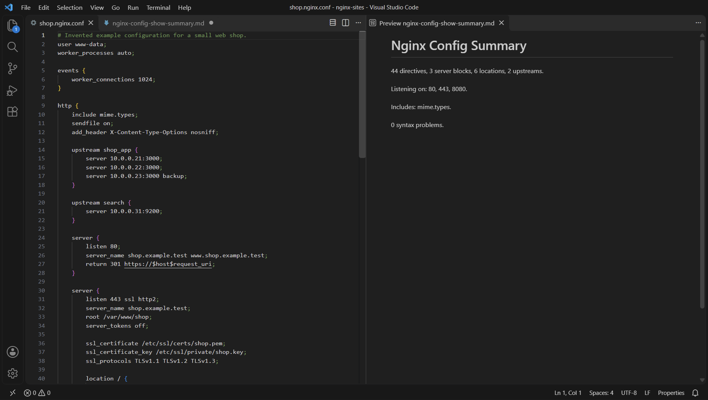
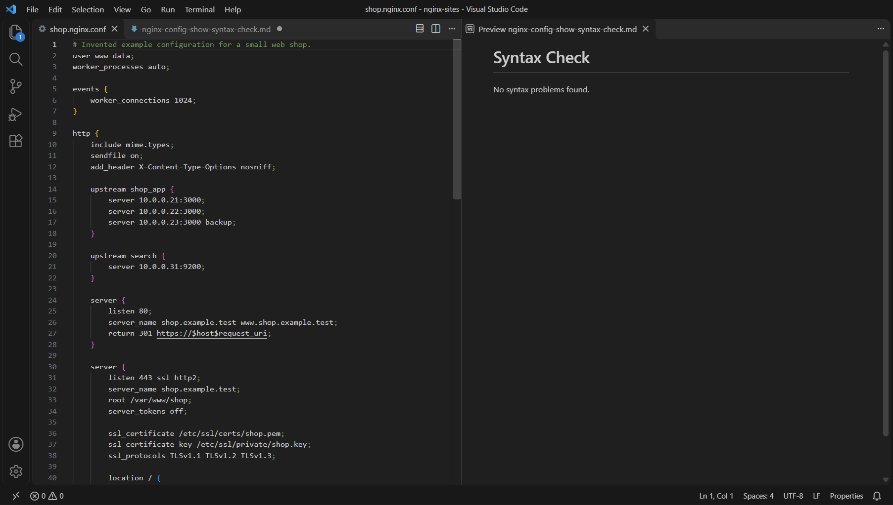
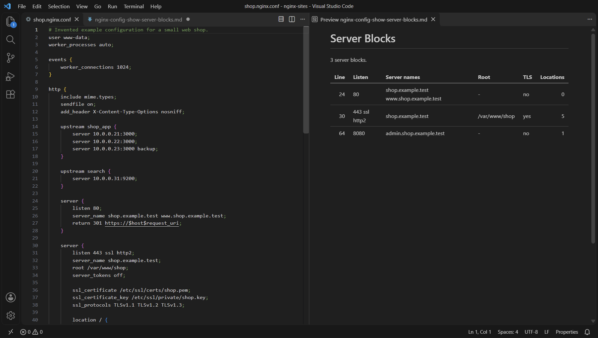
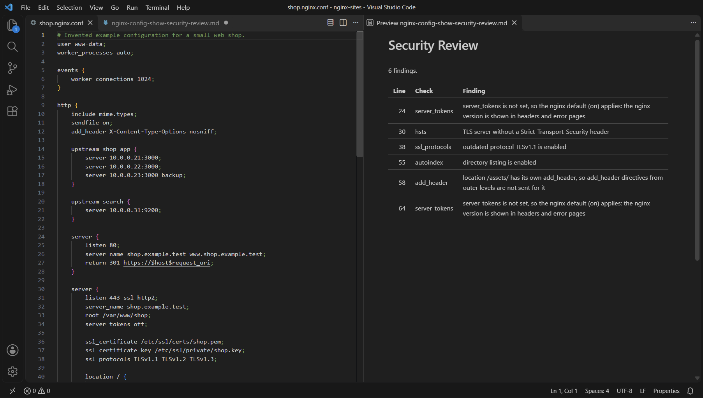
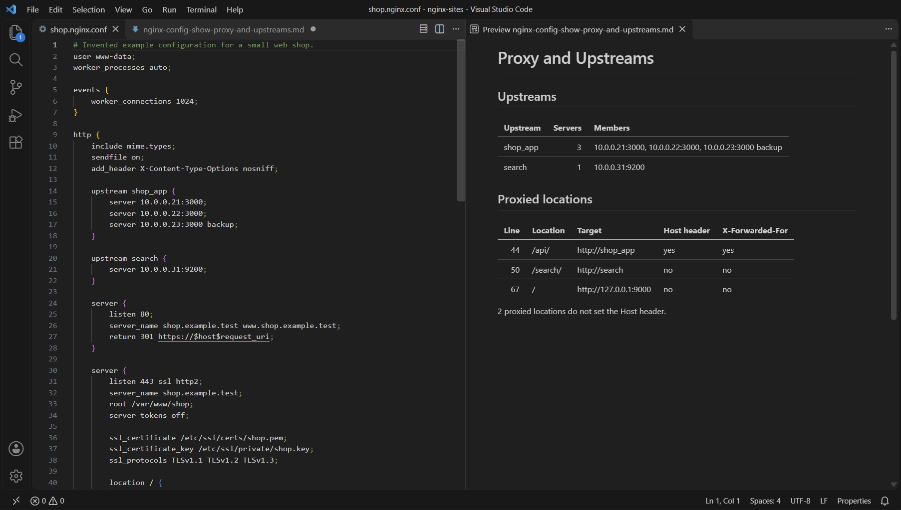

# Nginx Config Atlas

Nginx Config Atlas reads nginx configuration files and turns them into clear Markdown reports: what the file contains and which ports it listens on, syntax problems such as a missing semicolon or brace, every server block with its names, root and TLS, a security review (server_tokens, outdated TLS versions, missing Strict-Transport-Security, directory listings, add_header inheritance) and a review of upstreams and proxied locations, including the ones that do not pass the Host header.

Everything runs on your computer. There is no telemetry. The only network request the extension ever makes is the licence check for the optional Pro tier (see [Privacy](PRIVACY.md)).

## What it does

* **Show Summary**: The file at a glance: directives, server blocks, locations, upstreams, the ports it listens on, its includes and the number of syntax problems.
* **Show Syntax Check**: Syntax problems with their line: a missing semicolon, a missing or unexpected closing brace.
* **Show Server Blocks**: Every server block with its listen addresses, server names, root, TLS and number of locations.
* **Show Security Review** (Pro): server_tokens, outdated TLS versions, missing Strict-Transport-Security, directory listings and add_header inheritance.
* **Show Proxy And Upstreams** (Pro): Upstreams with their members, and every proxied location with its target and whether it passes the Host and X-Forwarded-For headers.

## Free, trial and Pro

| Feature | Free | Pro |
| --- | :---: | :---: |
| Show Summary | yes | yes |
| Show Syntax Check | yes | yes |
| Show Server Blocks | yes | yes |
| Show Security Review |  | yes |
| Show Proxy And Upstreams |  | yes |
| Open Sample File, walkthrough, Report A Problem | yes | yes |

The free reports need no key, no account and no network connection, and they will not be moved behind the licence key later. The first Pro command starts a **free 14-day trial** on this computer. After that, Pro is a one-time purchase, not a subscription: **Pro Personal USD 19** (one person, use at work allowed) or **Pro Business USD 39 per user** (one key per user of an organisation). A key works on up to 3 computers. The checkout page shows the final price and any taxes for your country. Licence keys are sold by Dodo Payments, the merchant of record. Details: [licence](docs/licence.md), [terms](TERMS.md).

## Commands

Open the Command Palette and type `Nginx Config Atlas`.

| Command | Tier |
| --- | :---: |
| Nginx Config Atlas: Show Summary | Free |
| Nginx Config Atlas: Show Syntax Check | Free |
| Nginx Config Atlas: Show Server Blocks | Free |
| Nginx Config Atlas: Show Security Review | Pro |
| Nginx Config Atlas: Show Proxy And Upstreams | Pro |
| Nginx Config Atlas: Open Sample File | Free |
| Nginx Config Atlas: Open Walkthrough | Free |
| Nginx Config Atlas: Show Documentation | Free |
| Nginx Config Atlas: Report A Problem | Free |
| Nginx Config Atlas: Buy Pro | Free |
| Nginx Config Atlas: Enter Licence Key | Free |
| Nginx Config Atlas: Show Licence Status | Free |
| Nginx Config Atlas: Remove Licence From This Machine | Free |

## Settings

| Setting | Default | Meaning |
| --- | --- | --- |
| `nginxConfigAtlas.maxFileSizeMB` | 50 | Largest file a report reads (0.1 to 50 MB; VS Code passes files only up to 50 MB to extensions). |
| `nginxConfigAtlas.openReportsAsPreview` | true | Open each report in the Markdown preview as well. |

## FAQ

**Does Nginx Config Atlas upload my configuration?**
No. Every report is created on your computer from the text in the editor, and nothing is sent anywhere.

**Does it follow include directives?**
No. It reads the open file only. Where a finding could be changed by an included file (a header set in a snippet, proxy headers from proxy_params), the report says that the setting is not in this file instead of claiming it is missing.

**Does it replace nginx -t?**
No. nginx -t checks that a configuration loads on that server, with every included file. Nginx Config Atlas explains a file while you edit it: what it contains, where the syntax is broken, and the security and proxy settings worth a second look.

**How does it treat add_header and proxy_set_header inheritance?**
As nginx does: a level inherits these directives from the nearest outer level only when it has none of its own. That is why a location with one add_header of its own drops every add_header of its server and http blocks, and the security review points this out.

## For IT and procurement

* Publisher: SmallStepsStudio (Visual Studio Marketplace), smallstepsstudio (Open VSX).
* Network: one host, `live.dodopayments.com`, for the licence check only, and only after a key is entered. No telemetry. The trial uses no network.
* Files are read from the editor only; the extension writes no files and changes none.
* Source: <https://github.com/small-steps-studio/nginx-config-atlas>.
* Licence agreement: [LICENSE.txt](LICENSE.txt). Terms: [TERMS.md](TERMS.md). Privacy: [PRIVACY.md](PRIVACY.md).

## Support

Run **Nginx Config Atlas: Report A Problem** or open an issue at <https://github.com/small-steps-studio/nginx-config-atlas/issues>. Never post a licence key or confidential data in a public issue.

NGINX is a trademark of F5, Inc.; Nginx Config Atlas is an independent product and is not affiliated with or endorsed by F5, Inc.
